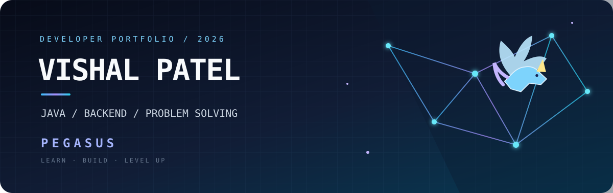

<!-- Vishal Patel | PEGASUS -->

 

### ⚡ PEGASUS
**Vishal Patel · Aspiring Software Developer**

*Java • Backend Engineering • Problem Solving*

---

## 01 — The Developer

B.Tech student at **Galgotias University**, focused on software development, Java, and backend engineering. I enjoy building practical applications, understanding how systems work, and improving my problem-solving skills through consistent practice.

- **Primary focus:** Java development and backend fundamentals
- **Problem solving:** Data Structures & Algorithms
- **Currently exploring:** Spring Boot, REST APIs, Python and data analytics
- **Build philosophy:** Understand the fundamentals, write maintainable code, and improve through iteration

## 02 — Tech Arsenal

**LANGUAGES**

**BACKEND & DATA**

**WEB & TOOLS**

## 03 — Projects & Repositories

| Project | Description | Links |
|---|---|---|
| **Bank Management System** | Java 17 banking workflow demo with Servlets, JDBC, MySQL and Docker Compose setup. | [Source code](https://github.com/vishalptl7275/Bankmanagement_System) |
| **Amazon & Flipkart Price Drop Alert** | Node.js Telegram bot prototype with MongoDB and scheduled price checks. Requires a running worker and credentials. | [Source code](https://github.com/vishalptl7275/Amazon-Flipkart-Price-Drop-Alert) |
| **Spotify-inspired Music App** | Full-stack music UI with authentication, playlists and liked songs, backed by Express and MySQL. Includes Docker setup. | [Source code](https://github.com/vishalptl7275/spotify_clone) |
| **Java Practice Projects** | Small Java console applications and learning exercises. | [Repository](https://github.com/vishalptl7275/internship) |

## 04 — Currently Leveling Up

| Focus area | Current direction |
|---|---|
| **Java & DSA** | Core Java, problem-solving patterns, data structures and algorithms |
| **Backend** | Spring Boot, REST APIs, database integration |
| **Python** | Programming fundamentals and data analysis |
| **Engineering** | Project structure, debugging, Git and clean code |

---

### 🪽 STAY CURIOUS. BUILD BOLDLY.

**PEGASUS MODE: ON**

Building fundamentals. Shipping projects. Getting better every day.

 

[Portfolio](https://vishalptl7275.github.io/vishalptl7275/) · [LinkedIn](https://linkedin.com/in/vishalptl8) · [LeetCode](https://leetcode.com/u/vishalpatel7275/) · [GitHub](https://github.com/vishalptl7275)

